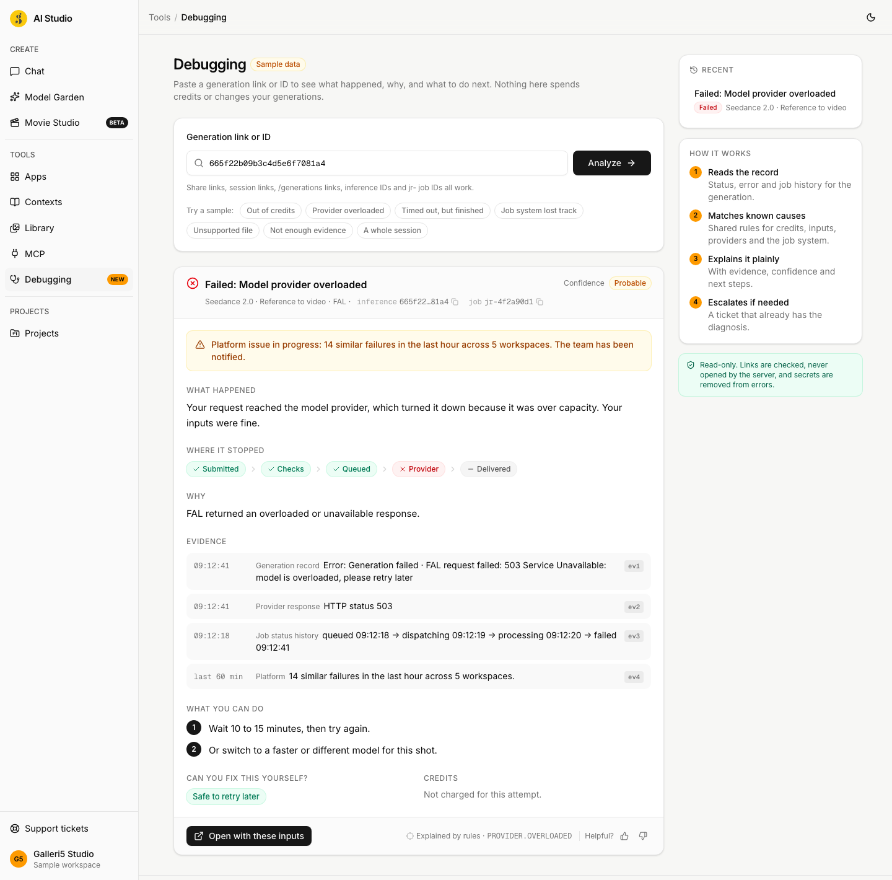
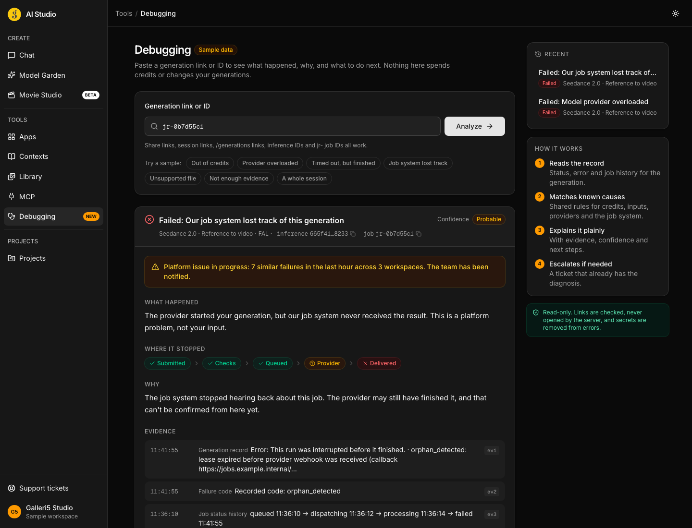
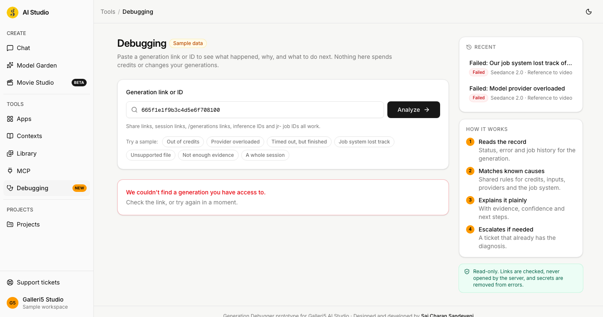
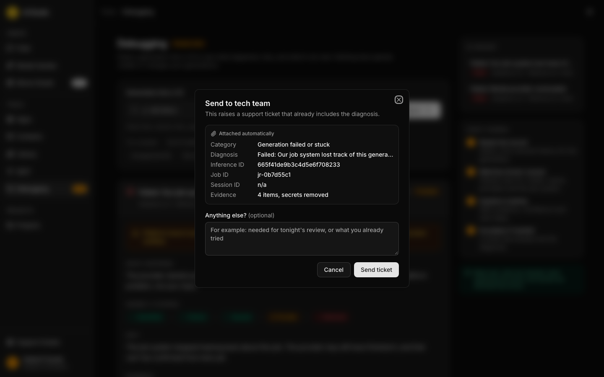

# G5 Generation Debugger

Self-service diagnosis for failed generations in **Galleri5 AI Studio**.

Paste a generation link (or click **Diagnose** on a failed result) and get, in seconds:

- **what happened**, in plain words
- **why**, with a confidence level: Confirmed, Probable, Possible, or Not enough evidence
- **where it stopped**: Submitted → Checks → Queued → Provider → Delivered
- **what to do next**, and whether you can fix it yourself
- **one-click escalation** into a support ticket that already contains the diagnosis



## Why

Today, when a generation fails, people post the link in a WhatsApp group and wait for someone technical to notice, or they raise a ticket that an admin then debugs by hand from scratch. Both paths depend on a person, and the WhatsApp path isn't tracked at all.

The platform already knows the cause of most failures: credit checks, provider overloads, unsupported files, job-router leases. This tool puts that knowledge in front of the person who hit the failure, and keeps engineers for problems that actually need them.

## What's inside

```
shared/     diagnostic-rules.json      one rule registry, used by both web and service
            sample-generations.json    sample records shaped like real AI Studio inferences
            expected-diagnoses.json    parity fixture: both engines must agree on these
web/        React + Vite + Tailwind v4 app in the AI Studio design system
service/    Python FastAPI diagnostics module, built to drop into the AI Studio backend
docs/       integration guide and screenshots
```

The web app runs on its own with sample data. Point it at the service for live data.

## Quick start

**Web (sample data, no backend needed)**

```bash
cd web
npm install
npm run dev            # http://localhost:5173
```

**Service**

```bash
cd service
python3 -m venv .venv && source .venv/bin/activate
pip install -e ".[dev]"
uvicorn app:app --reload --port 8000
```

**Web against the service (live mode)**

```bash
cd web
VITE_DIAGNOSTICS_API_URL=http://localhost:8000 npm run dev
```

The service allows `http://localhost:5173` by default. Set `CORS_ORIGINS` to change that.

**Deep link.** `/?inference-id=<id>` (or `/?ref=<any link>`) opens straight into a diagnosis. That's what a "Diagnose this generation" button in AI Studio would link to.

## Tests

```bash
cd service && pytest      # 62 tests: link parsing, redaction, rules, AI validator, API, access, rate limit
cd web && npm test        # 37 tests: the same parity fixture, link parsing, redaction
```

Both engines read the same rules and are checked against `shared/expected-diagnoses.json`, so they can't drift apart.

## How a diagnosis works

1. **Read the link.** It's parsed, never fetched. Only `https://aistudio.galleri5.com` is accepted, and IDs must look valid. Share links, session links, `/generations/<id>`, bare inference IDs and `jr-` job IDs all work. A session link with several generations shows a picker, failed ones first.
2. **Check access.** The same rule as viewing the generation. "Not found" and "no access" return the same answer, so IDs can't be probed.
3. **Collect evidence.** The generation record, live job status, job history, and how many similar failures happened across the platform in the last hour. Error text is scrubbed of tokens, keys, signed links and emails first.
4. **Classify with rules.** `shared/diagnostic-rules.json` maps error text, failure codes, statuses and HTTP codes to about 20 known causes, each with wording, next steps, who can fix it and what happens to credits. Nothing matches? The answer is "Not enough evidence", never a guess.
5. **Explain (optionally with AI).** See below.

| Confidence | Meaning |
|---|---|
| Confirmed | Stated directly by a structured signal, for example the job router's credit rejection with numbers |
| Probable | Strong text match, consistent with the timeline |
| Possible | Plausible, but the evidence is partial |
| Not enough evidence | No rule matched. Escalate with the evidence attached |

## Optional AI explanations

Rules always decide the diagnosis. An AI model can rewrite the explanation in friendlier words:

```bash
DIAGNOSTICS_LLM=gemini GEMINI_API_KEY=... uvicorn app:app --port 8000
```

- The model sees a sanitised evidence package only: no prompts, no asset links, no secrets. It has no tools.
- Its output is validated. It can't change the diagnosis, cite evidence that doesn't exist, add numbers that aren't in the evidence, raise the confidence, or include links, keys or emails. Anything that fails falls back to the rule text.
- It's skipped entirely for Confirmed causes, which already have reviewed wording.

## Safety

- **Read-only.** Nothing writes to generations, sessions or credits. No automatic retries: every new run goes through the normal Generate button and its credit estimate.
- **Links are parsed, not opened.** Host allowlist, no credentials or odd ports, ID format checks.
- **Uniform 404** for missing and forbidden generations. Reports are private to the person who ran them.
- **Rate limited** (30 per user per hour by default), with an **audit log** of who diagnosed what.
- **Secrets scrubbed** from every error before it is stored, shown or sent to an AI model.

## API

| Method | Path | Purpose |
|---|---|---|
| POST | `/api/v1/diagnostics` | `{ "reference": "<link or id>" }` → a diagnosis, or a session's candidate list |
| GET | `/api/v1/diagnostics/{id}` | Fetch a diagnosis you ran |
| POST | `/api/v1/diagnostics/{id}/escalate` | Raise a "Generation failed or stuck" ticket with the diagnosis attached |
| POST | `/api/v1/diagnostics/{id}/feedback` | `{ "helpful": bool, "wrong_cause": bool }` |
| GET | `/api/v1/diagnostics/samples` | Sample references (sample mode only) |

Interactive docs at `http://localhost:8000/docs` while the service runs.

## Adding a rule

1. Add an entry to `shared/diagnostic-rules.json` (order matters: the first match wins).
2. Add a sample record to `shared/sample-generations.json` and its expected code to `shared/expected-diagnoses.json`.
3. Run both test suites.

Every escalation that turns out to be a known cause is a candidate for a new rule. That's how the tool gets better over time.

## Connecting to the real AI Studio

This repo runs on sample data. [docs/integration.md](docs/integration.md) lists exactly what to plug in: the evidence source (inference records, Firestore job status, Job Router history), the existing auth and project-access checks, the support-ticket API, and the sidebar entry and "Diagnose" button in the frontend.

## Screenshots

| Dark mode, lost job | Session picker | Ticket with diagnosis |
|---|---|---|
|  |  |  |

---

Designed and developed by **Sai Charan Sandeveni**. Internal prototype for Galleri5 AI Studio.
